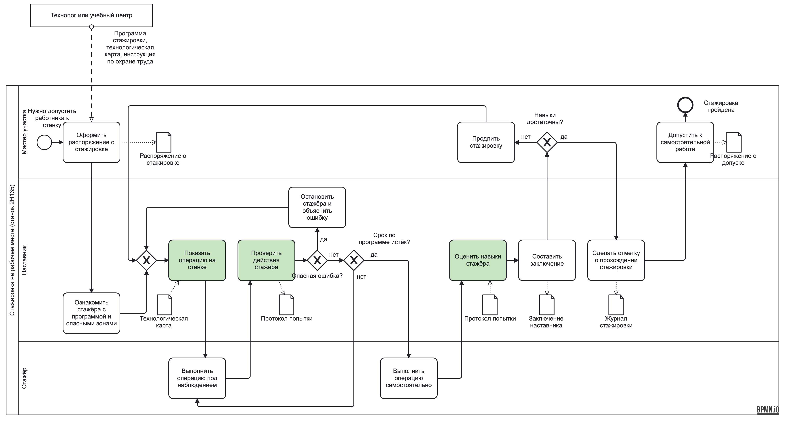
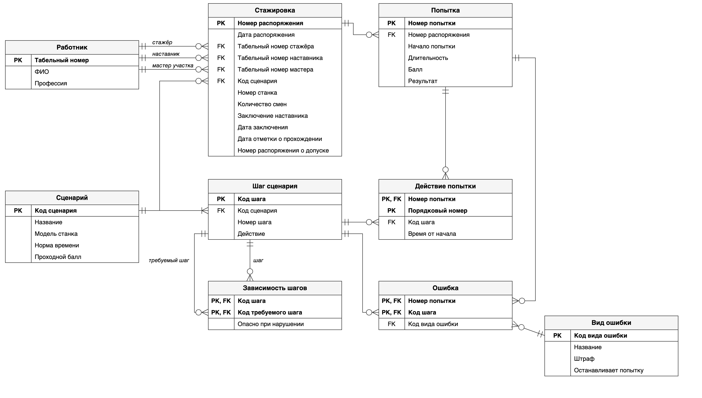
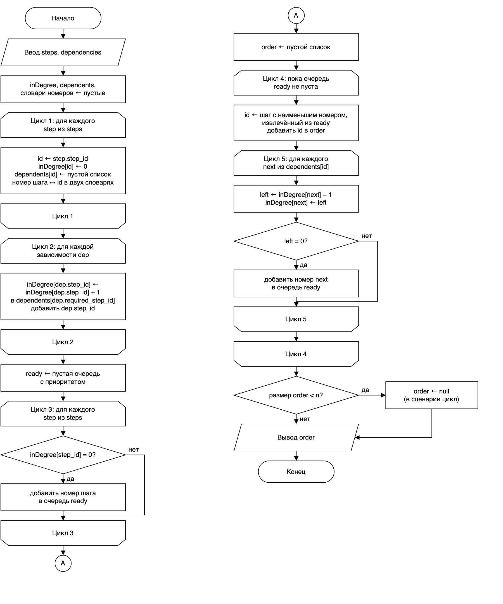
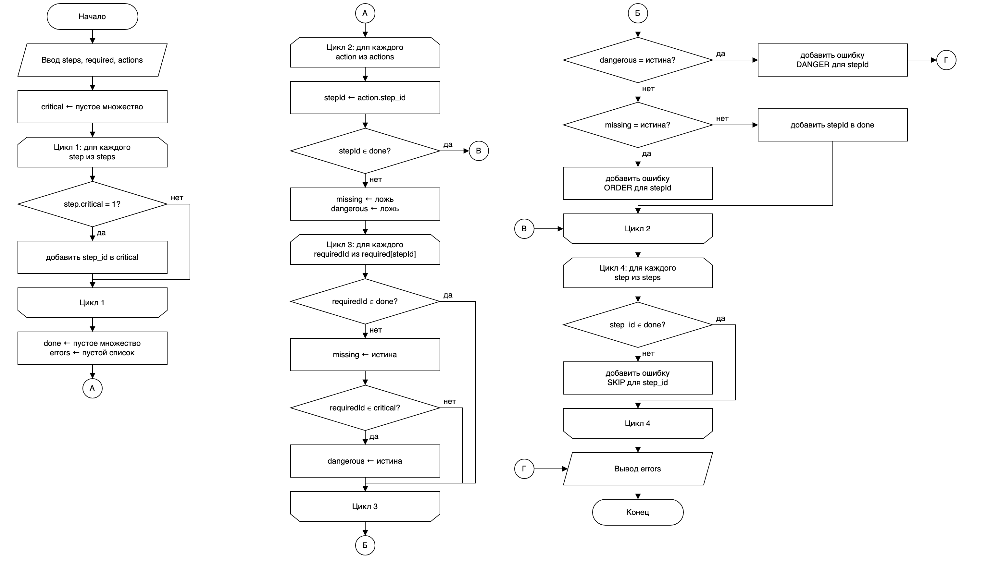

# Аналитический раздел

## Модель бизнес-процесса

Процесс стажировки, описанный в разделе 2, построен в нотации BPMN 2.0, которая закреплена стандартом ISO/IEC 19510 [20] и подробно разобрана в учебном пособии по моделированию бизнес-процессов [7]. Модель отражает текущее состояние, то есть стажировку без тренажёра, и повторяет шаги из подраздела 2.4 (рисунок 1).

Процесс изображён в виде пула «Стажировка на рабочем месте (станок 2Н135)», который разделён на три дорожки по участникам: «Мастер участка», «Наставник» и «Стажёр». Технолог или учебный центр в самой стажировке не участвует, поэтому он показан отдельным свёрнутым пулом. Из него в процесс поступает сообщение «Программа стажировки, технологическая карта, инструкция по охране труда», то есть те же документы, которые перечислены во входе процесса в подразделе 2.3. Процесс начинается событием «Нужно допустить работника к станку», после которого мастер участка оформляет распоряжение о стажировке, как и описано в подразделе 2.1. Заканчивается процесс событием «Стажировка пройдена», которое наступает после того, как работник допущен к самостоятельной работе.

Документы, которые передаются между шагами, показаны объектами данных. Распоряжение о стажировке появляется на выходе первой задачи мастера. Технологическая карта служит входом для задачи «Показать операцию на станке»: по ней наставник показывает шаги операции. Протокол попытки появляется на выходе задачи «Проверить действия стажёра» и служит входом для задачи «Оценить навыки стажёра». В текущем процессе роль протокола играют замечания наставника, которые он держит в памяти или записывает от руки и после стажировки не сохраняет, в чём и состоит узкое место 5 из подраздела 2.6. Заключение наставника передаётся мастеру, отметка о прохождении стажировки ставится в журнале стажировки, а итогом решения мастера становится распоряжение о допуске.



Модель показывает, что основную нагрузку в стажировке несёт наставник: на его дорожке находятся семь задач из двенадцати и три шлюза из четырёх, тогда как у стажёра всего две задачи. Три шлюза задают решения «Опасная ошибка?», «Срок по программе истёк?» и «Навыки достаточны?», а шлюз без подписи перед задачей «Показать операцию на станке» только сводит в один поток первый переход к показу и возвраты к нему. В модели есть три цикла, и все они проходят через действующий станок. После опасной ошибки процесс возвращается к показу операции, без опасной ошибки стажёр снова выполняет операцию под наблюдением, а при недостаточных навыках мастер продлевает стажировку, и она снова начинается с показа. Значит, каждая ошибка стажёра совершается на настоящем оборудовании и требует присутствия наставника. Кроме того, из цикла отработки стажёр выходит не тогда, когда перестаёт ошибаться, а когда истекает срок по программе. Окончание срока можно было бы показать промежуточным событием-таймером, однако шлюз нагляднее передаёт то, что наставник после каждой попытки решает, продолжать ли отработку. Отметка о прохождении стажировки ставится только после того, как мастер решил, что навыки достаточны, поэтому при продлении стажировки её нет.

Задачи, которые возьмёт на себя тренажёр, выделены на модели зелёным цветом. Они выбраны по узким местам из подраздела 2.6: тренажёр должен перенести первые ошибки стажёра с действующего станка на тренажёр, освободить время наставника и сделать оценку измеримой. Как сказано в подразделе 1.3, тренажёр не заменяет стажировку, поэтому ни одну из выделенных задач он не выполняет целиком. Он берёт на себя ту её часть, которую можно измерить: показ шагов в правильном порядке, проверку порядка действий и балл отдельной попытки, а решения и документы остаются за людьми. По этой причине не выделены задачи «Остановить стажёра и объяснить ошибку», «Составить заключение» и «Сделать отметку о прохождении стажировки»: объяснять ошибку, делать вывод о навыках и отвечать за отметку в журнале по-прежнему будет наставник. Для каждой выделенной задачи в таблице 1 указано, кто выполняет её сейчас, какую часть возьмёт система и какая функция программы за это отвечает.

Таблица 1 – Автоматизируемые операции

| № | Операция | Кто выполняет сейчас | Что будет делать система | Функция в коде |
|---|---|---|---|---|
| 1 | Показать операцию на станке | Наставник на действующем станке | Проверяет сценарий на циклические зависимости и показывает шаги на тренажёре в эталонном порядке, отмечая критичные шаги. На станке операцию по-прежнему показывает наставник, но уже после тренажёра | buildDemoOrder |
| 2 | Проверить действия стажёра | Наставник, наблюдая за стажёром | Сравнивает действия стажёра на тренажёре с зависимостями шагов, находит нарушения порядка, пропуски и опасные действия и прерывает попытку, если вид ошибки этого требует. На станке за стажёром следит наставник | checkActions |
| 3 | Оценить навыки стажёра | Наставник по своему опыту | Рассчитывает балл и результат одной попытки на тренажёре и записывает протокол попытки. Навыки в целом оценивает наставник по протоколам всех попыток | evaluateAttempt, saveAttempt |

После внедрения тренажёра процесс изменится так. Перед выходом к станку стажёр проходит обучение на тренажёре: смотрит шаги операции в эталонном порядке, а затем выполняет попытки, пока не наберёт проходной балл. Каждая попытка сохраняется в протоколе, поэтому первые ошибки, в том числе опасные, стажёр совершает на тренажёре, а не на станке. К станку он выходит уже подготовленным, и цикл отработки на оборудовании становится короче. Наставник разбирает со стажёром ошибки по протоколу, а не по памяти, и составляет заключение по протоколам попыток и собственному наблюдению на станке. Технолог по накопленным протоколам видит, на каких шагах новички ошибаются чаще всего.

## Логическая модель данных

Логическая модель описывает, какие данные нужны тренажёру и как они связаны между собой, без привязки к конкретной СУБД. Поэтому типы атрибутов в ней не указываются, а имена атрибутов записаны по-русски. Модель построена в нотации «воронья лапка» (crow's foot), в которой мощность связи показывается символами на концах линии (рисунок 2).



Сущности модели выросли из объектов данных BPMN-модели. Технологическая карта задаёт эталон операции, поэтому из неё получились «Сценарий», «Шаг сценария» и «Зависимость шагов». Из протокола попытки получились «Попытка», «Действие попытки» и «Ошибка», а штрафы за ошибки вынесены в справочник «Вид ошибки». Распоряжение о стажировке, заключение наставника, отметка о прохождении и распоряжение о допуске описывают одну и ту же стажировку, поэтому они стали атрибутами сущности «Стажировка». Участники процесса – стажёр, наставник и мастер участка – представлены сущностью «Работник». Назначение сущностей, их атрибуты и ключи приведены в таблице 2.

Таблица 2 – Сущности логической модели

| Сущность | Назначение | Атрибуты | Первичный ключ | Внешние ключи |
|---|---|---|---|---|
| Работник | Работник предприятия, который участвует в стажировке в одной из ролей | Табельный номер, ФИО, профессия | Табельный номер | – |
| Сценарий | Эталон операции из технологической карты | Код сценария, название, модель станка, норма времени, проходной балл | Код сценария | – |
| Шаг сценария | Одно действие операции | Код шага, код сценария, номер шага, действие, критичность | Код шага | Код сценария |
| Зависимость шагов | Требование выполнить один шаг раньше другого | Код шага, код требуемого шага | Код шага, код требуемого шага | Код шага, код требуемого шага |
| Стажировка | Стажировка по распоряжению мастера и её итог | Номер распоряжения, дата распоряжения, табельные номера стажёра, наставника и мастера, код сценария, номер станка, количество смен, заключение наставника, дата заключения, дата отметки о прохождении, номер распоряжения о допуске | Номер распоряжения | Табельные номера стажёра, наставника и мастера, код сценария |
| Попытка | Одно прохождение сценария на тренажёре | Номер попытки, номер распоряжения, начало попытки, длительность, балл, результат | Номер попытки | Номер распоряжения |
| Действие попытки | Шаг, выполненный стажёром в попытке | Номер попытки, порядковый номер, код шага, время от начала | Номер попытки, порядковый номер | Номер попытки, код шага |
| Вид ошибки | Справочник видов ошибок | Код вида ошибки, название, штраф, останавливает попытку | Код вида ошибки | – |
| Ошибка | Ошибка, найденная в попытке | Номер ошибки, номер попытки, код шага, код вида ошибки | Номер ошибки | Номер попытки, код шага, код вида ошибки |

Сущности связаны следующим образом:

1) один работник может участвовать в нескольких стажировках в разных ролях – как стажёр, как наставник или как мастер участка, а у каждой стажировки ровно один стажёр, один наставник и один мастер. Поэтому «Стажировка» связана с «Работником» тремя связями «один ко многим»;

2) по одному сценарию может проводиться много стажировок, а каждая стажировка проходит по одному сценарию;

3) сценарий состоит из одного или нескольких шагов, а каждый шаг принадлежит одному сценарию;

4) в рамках стажировки стажёр может сделать несколько попыток или ни одной, а каждая попытка относится к одной стажировке;

5) попытки и шаги связаны отношением «многие ко многим»: в одной попытке выполняется много шагов, а один шаг выполняется во многих попытках, причём в одной попытке иногда несколько раз. Эта связь разрешена ассоциативной сущностью «Действие попытки», у которой есть собственные атрибуты – порядковый номер и время от начала попытки;

6) шаги связаны между собой тоже отношением «многие ко многим»: шаг может требовать нескольких предыдущих шагов и сам может быть нужен нескольким следующим. Эта связь вынесена в ассоциативную сущность «Зависимость шагов», оба атрибута которой ссылаются на «Шаг сценария»;

7) в попытке может быть найдено несколько ошибок или ни одной, а каждая ошибка относится к одной попытке, одному шагу и одному виду ошибки.

Модель приведена к третьей нормальной форме (3НФ) с одним осознанным исключением, о котором сказано ниже. Требования нормальных форм проверялись по порядку, как это принято при проектировании баз данных [12].

Первая нормальная форма (1НФ) требует, чтобы все атрибуты были атомарными, а повторяющихся групп не было. Например, действия стажёра можно было бы хранить в попытке одной строкой «101, 103, 102, …». Однако тогда эту строку пришлось бы разбирать при каждой проверке, а на отдельное действие нельзя было бы сослаться. Поэтому каждое действие хранится отдельным экземпляром сущности «Действие попытки». По той же причине зависимости шагов не перечисляются в шаге через запятую, а вынесены в отдельную сущность.

Вторая нормальная форма (2НФ) важна для сущностей с составным ключом, то есть для «Действия попытки» и «Зависимости шагов». Каждый неключевой атрибут должен зависеть от ключа целиком, а не от его части. В «Действии попытки» шаг и время зависят от пары «попытка, порядковый номер»: по одному номеру попытки нельзя узнать, какой шаг выполнен. Если бы в эту сущность добавили время начала попытки, оно зависело бы только от номера попытки и повторялось бы в каждом действии. Поэтому время начала хранится в «Попытке». У «Зависимости шагов» неключевых атрибутов нет, так что требование 2НФ для неё выполняется сразу.

Третья нормальная форма (3НФ) запрещает неключевому атрибуту зависеть от другого неключевого атрибута. Например, штраф определяется видом ошибки, а не конкретной ошибкой. Если бы штраф хранился в «Ошибке», возникла бы цепочка «номер ошибки → код вида ошибки → штраф», и при изменении штрафа пришлось бы исправлять все ошибки этого вида. Поэтому штраф и признак остановки попытки вынесены в справочник «Вид ошибки». Точно так же в «Стажировке» хранятся только табельные номера работников, а их ФИО – в «Работнике», а сценарий попытки определяется через стажировку и в самой попытке не повторяется.

Балл и результат попытки – производные данные: они вычисляются по ошибкам попытки и штрафам из справочника видов ошибок, а значит, повторяют сведения, которые уже есть в «Ошибке» и «Виде ошибки». Поэтому их хранение в «Попытке» – осознанная денормализация. Она нужна потому, что правила штрафов со временем могут меняться, а итог уже прошедшей попытки, по которому наставник составлял заключение, должен остаться прежним.

## Алгоритмы

Для автоматизируемых операций разработаны два основных алгоритма: построение порядка показа шагов (функция buildDemoOrder) и проверка действий стажёра (функция checkActions). Блок-схемы выполнены по ГОСТ 19.701-90 [6]. Начало и конец обозначены терминаторами, ввод и вывод данных – параллелограммами, условия – ромбами с выходами «да» и «нет», а начало и конец цикла – парными символами границы цикла. Схема не помещается в один столбец, поэтому её части соединены соединителями с буквами.

При оценке сложности используются следующие обозначения:

1) n – число шагов сценария;

2) d – число зависимостей между шагами;

3) k – число действий в попытке;

4) e – число найденных ошибок.

В учебном сценарии n = 12, d = 16 и k = 12. Сложность оценивается для худшего случая, как принято в анализе алгоритмов [4; 16]. Исключение составляют операции словаря HashMap и множества HashSet: в среднем они выполняются за O(1), а в худшем случае, когда у многих ключей совпадают хеш-коды, начиная с Java 8 такие ключи хранятся в сбалансированном дереве и операция занимает O(log n) [21]. Ключами в программе служат строковые коды шагов, для которых такое совпадение маловероятно, поэтому для этих операций ниже указывается ожидаемое время O(1).

### Построение порядка показа шагов

В режиме «Обучение» тренажёр показывает стажёру шаги операции. Порядок показа должен соблюдать все зависимости: например, сверло нельзя устанавливать раньше, чем осмотрены ограждения. Такая задача сводится к топологической сортировке ориентированного графа, в котором вершины – шаги, а дуги – зависимости [16]. В учебном сценарии нумерация шагов уже согласована с зависимостями, поэтому алгоритм выдаёт порядок 1–12. Однако сценарий составляет технолог, и при его изменении в зависимостях может появиться противоречие, например «шаг 4 требует шаг 6, а шаг 6 – шаг 4». Тогда допустимого порядка нет, и тренажёр не должен показывать такой сценарий. Если же нумерация просто расходится с зависимостями, алгоритм строит допустимый порядок, ближайший к нумерации. Поэтому назначение алгоритма – проверка корректности сценария и построение эталонного порядка показа. Использован алгоритм Кана: шаг становится доступным, когда выполнены все требуемые им шаги, и из доступных шагов каждый раз выбирается шаг с наименьшим номером. Поэтому доступные шаги хранятся в очереди с приоритетом.

Схема алгоритма приведена на рисунке 3. Циклы 1 и 2 строят для каждого шага число ещё не выполненных требований inDegree и список зависимых шагов dependents. Цикл 3 помещает в очередь шаги, которые ничего не требуют. Цикл 4 извлекает из очереди очередной шаг и добавляет его в порядок показа, а вложенный в него цикл 5 уменьшает число требований у зависимых шагов и ставит в очередь те из них, у которых требований не осталось. Если в зависимостях есть цикл, входящие в него шаги в очередь так и не попадут. Поэтому в конце алгоритм сравнивает длину полученного порядка с числом шагов и при расхождении возвращает значение null, а команда demo сообщает о циклической зависимости.



Циклы 4 и 5 функции buildDemoOrder и проверка на цикл приведены в листинге 1.

Листинг 1 – Циклы 4 и 5 функции buildDemoOrder и проверка на цикл

```java
List<String> order = new ArrayList<>();
while (!ready.isEmpty()) {
    String id = idByNumber.get(ready.poll());
    order.add(id);
    for (String next : dependents.get(id)) {
        int left = inDegree.get(next) - 1;
        inDegree.put(next, left);
        if (left == 0) {
            ready.add(numberById.get(next));
        }
    }
}
if (order.size() < steps.size()) {
    return null;
}
return order;
```

Цикл 1 выполняется n раз, а цикл 2 – d раз. Операции get и put словаря HashMap занимают ожидаемое время O(1) [17], поэтому оба цикла вместе дают O(n + d). Цикл 3 выполняется n раз, и каждое добавление в очередь PriorityQueue, устроенную как двоичная куча, стоит O(log n) [16], то есть цикл 3 даёт O(n log n). Каждый шаг попадает в очередь ровно один раз, поэтому цикл 4 тоже выполняется n раз, а извлечение poll стоит O(log n). Вложенный цикл 5 за один проход цикла 4 выполняется столько раз, сколько шагов зависят от извлечённого шага, а за все проходы – ровно d раз, так как каждая зависимость просматривается один раз. Добавлений в очередь внутри цикла 5 в сумме не больше n, а проверка длины в конце занимает O(1). В итоге:

T(n, d) = O(n + d) + O(n log n) + O(n log n) + O(d) = O(n log n + d).

Хотя циклы 4 и 5 вложены, их общая сложность не равна произведению n на d. В худшем случае каждый шаг зависит от всех предыдущих, тогда d = n(n – 1) / 2, и сложность становится O(n²). Дополнительная память складывается из словарей и очереди размером O(n) и списков зависимых шагов размером O(n + d), то есть равна O(n + d). Для учебного сценария циклы 1, 3 и 4 выполняются по 12 раз, а цикл 2 и вложенный цикл 5 в сумме – по 16 раз.

### Проверка действий стажёра

Функция checkActions получает шаги сценария, словарь required, в котором для каждого шага перечислены требуемые шаги, действия попытки в порядке их выполнения и справочник видов ошибок. Она находит ошибки трёх видов: нарушение порядка (ORDER), пропуск шага (SKIP) и опасное действие (DANGER). Действие выполнено правильно, если все требуемые им шаги уже выполнены. Если хотя бы один требуемый шаг не выполнен, это нарушение порядка. Если же среди невыполненных есть критичный шаг, например «Снять перчатки» перед пробным пуском, действие считается опасным. Прерывать ли после него попытку, функция решает по признаку «Останавливает попытку» из справочника, так же как функция evaluateAttempt. Для опасного действия этот признак установлен, поэтому попытка прерывается так же, как её прервал бы наставник. Шаги, которые так и не были выполнены, в конце отмечаются как пропущенные.

Шаг, выполненный не по порядку, после штрафа всё равно засчитывается как выполненный. Иначе одна ошибка вызывала бы цепочку других: все шаги, которые от него зависят, тоже получали бы штраф за порядок, а пробный пуск мог бы оказаться опасным действием, хотя все нужные шаги стажёр выполнил. Например, если в попытке 3 поменять местами шаги 4 и 6, которые стажёр выполнил подряд, программа находит одну ошибку ORDER на шаге 6 и ставит 90 баллов. По той же причине за один шаг нельзя получить одновременно ORDER и SKIP: выполненный шаг уже не считается пропущенным. Повторное действие по уже выполненному шагу пропускается.

Схема алгоритма приведена на рисунке 4. Цикл 1 собирает множество критичных шагов critical. Цикл 2 перебирает действия, а вложенный в него цикл 3 проверяет требуемые шаги текущего действия и выставляет признаки missing и dangerous. После цикла 3 по этим признакам выбирается ветвь. При опасном действии записывается ошибка DANGER, и если этот вид ошибки останавливает попытку, ошибки сразу выводятся через соединитель Г. При нарушении порядка записывается ошибка ORDER. Если попытка не остановлена, шаг затем добавляется в множество выполненных шагов done. Цикл 4 находит пропущенные шаги.



Циклы 2 и 3 функции checkActions приведены в листинге 2.

Листинг 2 – Циклы 2 и 3 функции checkActions

```java
for (Map<String, String> action : actions) {
    String stepId = action.get("step_id");
    if (done.contains(stepId)) {
        continue;
    }
    boolean missing = false;
    boolean dangerous = false;
    for (String requiredId : required.getOrDefault(stepId, List.of())) {
        if (!done.contains(requiredId)) {
            missing = true;
            if (critical.contains(requiredId)) {
                dangerous = true;
            }
        }
    }
    if (dangerous) {
        errors.add(newError(stepId, "DANGER"));
        if (errorKinds.get("DANGER").get("stops_attempt").equals("1")) {
            return errors;
        }
    } else if (missing) {
        errors.add(newError(stepId, "ORDER"));
    }
    done.add(stepId);
}
```

Циклы 1 и 4 выполняются по n раз, а операции contains и add множества HashSet занимают ожидаемое время O(1) [17]. Цикл 2 выполняется k раз. Вложенный цикл 3 за один проход цикла 2 просматривает требования текущего шага, а за все проходы – не больше d требований в сумме, так как каждый шаг проверяется один раз: повторное действие по выполненному шагу пропускается ещё до цикла 3. Отсюда:

T(n, k, d) = O(n) + O(k + d) + O(n) = O(n + k + d).

В худшем случае каждый шаг требует все предыдущие, тогда d = n(n – 1) / 2, и сложность становится O(k + n²). Ранний выход при опасном действии на практике сокращает работу, но оценку худшего случая не меняет. Дополнительная память – множества critical и done размером O(n) и список ошибок. Каждый шаг даёт не больше одной ошибки, поэтому ошибок не больше n, и вся дополнительная память равна O(n). Для попытки 2 из учебных данных циклы 1, 2 и 4 выполняются по 12 раз, а вложенный цикл 3 в сумме – 15 раз.

Остальные функции проще и содержат по одному циклу. Сводная оценка приведена в таблице 3.

Таблица 3 – Оценка сложности функций

| Функция | Сколько раз выполняются циклы | Время работы | Дополнительная память |
|---|---|---|---|
| buildDemoOrder | n, d, n, n и вложенный – d в сумме | O(n log n + d) | O(n + d) |
| checkActions | n, k, вложенный – не более d в сумме, n | O(n + k + d) | O(n) |
| evaluateAttempt | e | O(e) | O(1) |
| orderBySeq | k | O(k) | O(k) |

Функция orderBySeq раскладывает действия по порядковому номеру в заранее созданный список, а не сортирует их. Поэтому она работает за O(k), тогда как сортировка заняла бы O(k log k).

## Процедурная реализация

Алгоритмы реализованы на языке Java 21 в процедурном стиле в файле src/Trainer.java (в репозитории этот каталог называется procedural). Программа состоит из одного класса Trainer с методом main и статическими методами. Собственных классов, записей и глобальных изменяемых переменных в ней нет: единственное поле класса – константа SEPARATOR с разделителем столбцов. Данные передаются между функциями через параметры и возвращаемые значения, а каждая строка таблицы хранится как словарь «название столбца – значение».

Данные лежат в каталоге src/data в виде CSV-файлов, по одному на каждую сущность логической модели. Так процедурная версия работает с той же структурой данных, которую на проектном этапе предстоит перенести в PostgreSQL. Учебные данные описывают одну стажировку по сценарию из 12 шагов и три попытки стажёра.

Функции программы делятся на пять групп:

1) readColumns, readTable и writeTable читают и записывают таблицу CSV;

2) indexBy и filterBy строят словарь строк по значению столбца и отбирают строки с заданным значением;

3) requiredSteps, dependenciesOf и orderBySeq готовят входные данные для алгоритмов, причём dependenciesOf оставляет только зависимости, оба шага которых принадлежат сценарию;

4) buildDemoOrder, checkActions, evaluateAttempt и saveAttempt выполняют автоматизируемые операции из таблицы 1, а newError создаёт запись об ошибке;

5) runDemo и runCheck реализуют команды demo и check, а printUsage выводит подсказку при неверной команде.

Функция evaluateAttempt вычитает из 100 баллов штрафы за все найденные ошибки, беря их из справочника видов ошибок. Если среди ошибок есть вид, который останавливает попытку, результат – «остановлена». В остальных случаях попытка сдана, если балл не ниже проходного, а время не больше нормы сценария. Функция saveAttempt записывает балл и результат в attempts.csv, а ошибки – в errors.csv, заменяя прежние ошибки этой попытки, поэтому повторная проверка не создаёт дубликатов. Номера ошибок при этом не меняются: ошибкам попытки возвращаются её прежние номера, новые ошибки получают номера после наибольшего, а ошибки других попыток не затрагиваются. Так первичный ключ ошибки не меняется задним числом.

Программа собирается и запускается из каталога src командами, приведёнными в листинге 3.

Листинг 3 – Команды сборки и запуска программы

```bash
javac -encoding UTF-8 -d out Trainer.java
java -cp out Trainer demo data 1
java -cp out Trainer check data 2
```

Первая команда запуска проверяет сценарий 1 на циклические зависимости и выводит его шаги в порядке показа, отмечая критичные шаги, вторая проверяет попытку 2. Вывод программы для неё приведён в листинге 4.

Листинг 4 – Вывод программы при проверке попытки 2

```
Попытка 2 от 2026-10-13 10:05, стажировка № 47, стажёр Сидоров Артём Игоревич
Сценарий: Подготовка станка 2Н135 и сверление отверстия
Действия стажёра:
  1. Надеть защитные очки
  2. Снять перчатки
  3. Застегнуть спецодежду
  4. Установить сверло в патрон
  5. Осмотреть ограждения и органы управления
  6. Установить сверло в патрон
  7. Вынуть ключ из патрона
  8. Закрепить заготовку в тисках
  9. Выставить подачу
  10. Выставить частоту вращения шпинделя
  11. Выполнить пробный пуск на холостом ходу
  12. Просверлить отверстие
Ошибки:
  шаг 6 «Установить сверло в патрон» – Нарушен порядок шагов (−10)
  шаг 12 «Остановить шпиндель» – Шаг пропущен (−15)
Время: 560 с при норме 600 с
Балл: 75 из 100, проходной 80
Результат: не сдано
Протокол записан в attempts.csv и errors.csv
```

В этой попытке стажёр установил сверло раньше, чем осмотрел ограждения, а в конце не остановил шпиндель. Повторная установка сверла (действие 6) ошибкой не считается: по уже выполненному шагу штраф не начисляется. Попытка 1 прерывается с результатом «остановлена» и баллом 0, так как стажёр перешёл к пробному пуску, не сняв перчатки и не вынув ключ из патрона. В попытке 3 стажёр сначала застегнул спецодежду и надел защитные очки и только потом перешёл к осмотру станка, а все шаги выполнил без ошибок за 470 с, поэтому получил результат «сдано» с баллом 100. Средства индивидуальной защиты в сценарии – обязательное условие осмотра станка: шаг 4 требует шагов 1 и 2. Порядок сборки, формат входных данных и ожидаемый вывод описаны также в файле src/README.md.
